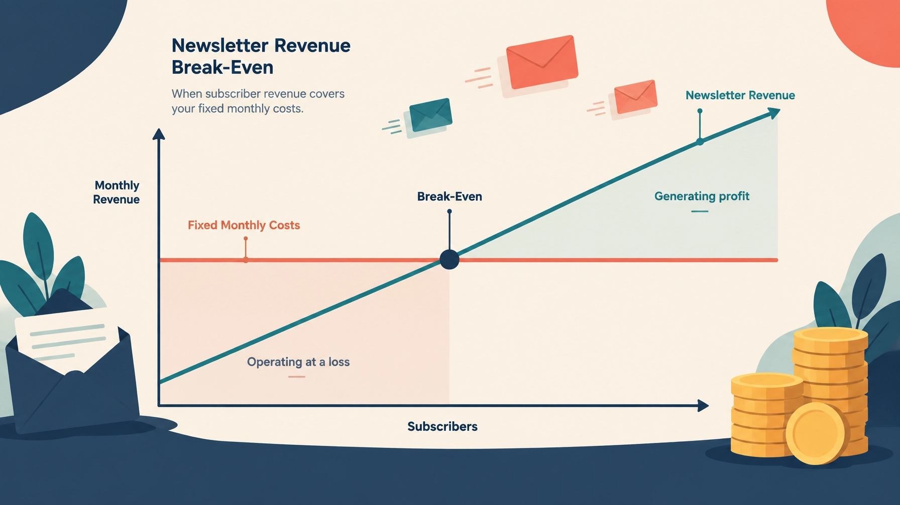

Substack doesn't send you a bill. That's the pitch, and a lot of writers feel like it's the right one. But a platform that takes a share of every paid subscription gets more expensive the better you do.

So I ran the numbers. Here's what I assumed: 5,000 subscribers, up to 50,000 emails a month, a fixed platform bill of $89–$239 a month, and a three-year horizon. I kept Stripe's payment processing out of the platform cost at 2.9% plus 30 cents on each successful charge for standard US cards, as of September 2026, because you pay it wherever your newsletter lives.

I've been building websites for publishers since 1998, and I've watched this decision get made at very different sizes — a writer with a couple hundred readers, a publication with a few thousand, a newsletter that turned into a small media company. The right answer moves as the business does.

Substack's own description of its model is fair: no upfront cost, and the platform makes money when you do. When cash flow is unpredictable, that's a reasonable deal. The question is what happens once revenue gets steady.

> Affiliate disclosure: Some links in this post lead to affiliate sites that generate commissions for Johns & Taylor. That doesn't change how I evaluate the costs or trade-offs described here.

## Percentage vs. fixed

Substack takes a percentage of paid subscription revenue, on top of card processing. Its site currently says writers keep 90% before card fees. Terms change, so treat that as today's number, not a permanent one.

The alternatives flip the formula. You pay a monthly platform bill, plus processing, a domain, and some maintenance. A percentage grows with your revenue. A fixed bill doesn't.

These are the planning figures for the three setups Johns & Taylor has deployed for clients ([planning figures](https://hoagiestack.com/alternatives) as of September 2026):

| Solution | Planning cost per month | Annual fixed cost | Three-year fixed cost |
| --- | --- | --- | --- |
| Kit | **$89** | **$1,068** | **$3,204** |
| Ghost | **$239** | **$2,868** | **$8,604** |
| WordPress | **$149** | **$1,788** | **$5,364** |

They assume 5,000 subscribers across free and paid tiers, up to 50,000 emails a month, and $10–$20 a year for a domain. Vendor prices and subscriber thresholds shift often, so check the [Kit](https://kit.com/pricing) and [Ghost](https://ghost.org/pricing/) pricing pages before you commit.

One wrinkle on Kit: paid newsletters don't go straight through your own Stripe account. They run through Kit's commerce layer at 3.5% + 30¢ per transaction, processing included. That's close to what you'd pay Stripe anyway, but it's still a percentage, and it belongs in the math.

The WordPress number is deliberately fuller than a hosting quote. It reflects the managed setup Johns & Taylor runs for clients, covering monthly hosting and email delivery plus expert setup and annual maintenance spread across the year. A $10 hosting plan is real. It just isn't what it costs to run a secure paid publication.

## Where fixed cost starts to win

Say the platform share is 10%. Divide each fixed bill by that and you get the monthly revenue where the two cost the same: $890 for Kit, $2,390 for Ghost, $1,490 for WordPress.

Under roughly $800–$1,000 a month in paid revenue, the percentage model can genuinely be cheaper. That's what the arithmetic shows at this revenue level. The ownership argument in the first post in this series is a separate question.

At $2,000 a month, 10% is $200 — more than double Kit's bill, above the managed WordPress figure, and closing on Ghost's $239, before you count anything else you get from owning the setup.

| Monthly paid revenue | Illustrative 10% platform share | Kit | Ghost | WordPress |
| --- | --- | --- | --- | --- |
| **$100** | **$10** | $89 | $239 | $149 |
| **$500** | **$50** | $89 | $239 | $149 |
| **$1,000** | **$100** | $89 | $239 | $149 |
| **$2,000** | **$200** | $89 | $239 | $149 |

Subscriber count on its own won't tell you much. Five thousand free subscribers bringing in $0 is a completely different cost picture from 5,000 subscribers bringing in $2,000 a month.

## Three alternatives, three kinds of cost

### Kit

In this model, Kit runs $89 a month, or $1,068 a year. What sets it apart is the Creator Network, which recommends your newsletter to readers of other Kit creators and can take some of the audience-building work off your plate.

That's worth something, but it isn't guaranteed revenue. Recommendations depend on fit, on who else participates, and on rules Kit can change. There's no self-hosted version, either — you're trading infrastructure control for convenience. I'd look hardest at Kit when the job is growing an email list through referrals, automations, and paid tiers.

### Ghost

Ghost comes in at $239 a month, or $2,868 a year. That's Ghost's Business plan billed monthly, including priority support, and the same plan is $199 a month if billed annually; Ghost prices by member count, so a 5,000-member list lands on Business rather than Publisher. It's the closest thing to Substack: website, newsletter, member accounts, and paid subscriptions built as one product. That means less time wiring plugins together and more time writing, and the hosted version handles most of the operations work. Ghost takes no cut of subscription revenue.

Ghost is also open source, so you can host it yourself. But self-hosting isn't a matter of clicking "export." You're taking on servers, updates, backups, security, email configuration, and troubleshooting.

Ghost has more discovery than it used to. Publications can recommend each other, sites get listed in Ghost's Explore directory, and its ActivityPub integration lets people follow you from Mastodon, Threads, and other corners of the open social web. It still doesn't have the pull of Substack's app or Kit's Creator Network, so you'll do more of your own distribution.

### WordPress

WordPress runs $149 a month in this comparison, or $1,788 a year — and again, that covers hosting, email delivery, setup, and maintenance on top of the software.

WordPress moves between hosts easily, and there's a free or commercial plugin for nearly anything: memberships, paywalls, payments, analytics, editorial workflows. That matters when a newsletter grows into a publication, an events business, a research service, or a membership community.

The price of that flexibility is upkeep. A WordPress site needs updates, backups, monitoring, and real security practices no matter how small it is, and every plugin you add is one more thing to keep compatible. There's no built-in network, either. Growth comes from your own channels, partnerships, search, and referrals.

If you want portability and room to grow the business, that trade can be worth it. If you'll never use the extra flexibility, it probably isn't. The [WordPress plugin directory](https://wordpress.org/plugins/) gives you a sense of the ecosystem.

## Total cost is more than the invoice

Over three years, under these assumptions, Kit costs $3,204, Ghost $8,604, and WordPress $5,364, before domain and processing. The gap between Kit and WordPress is $2,160. Sixty bucks a month.

That can still be worth it if WordPress saves you a painful migration later. It's harder to justify if you never need what WordPress does.

Some costs never show up on an invoice at all. Moving a list, an archive, paid tiers, URLs, and subscriber permissions can take days or weeks, and an easy move today doesn't promise an easy one in three years. A platform with recommendations may save you acquisition work; one without means more partnerships, search work, or paid promotion. Hosted services take servers and security off your plate, while WordPress needs attention even when someone else handles the routine maintenance. And if you might add sponsorships, courses, events, premium archives, or more writers down the road, the platform that's cheapest now could be the one that boxes you in.

## What I'd do at each stage

Under $500 a month in paid revenue, I'd keep risk low and focus on building the audience. The reason to understand the percentage model at this stage is arithmetic: it can cost less than a fixed bill. The recommendation in this series still points at the three fixed-cost setups below.

Between about $500 and $1,000, I'd plug the real platform share into the math against the fixed options. It's close in this range, and fit matters as much as arithmetic.

Past $1,000 a month, I'd take fixed pricing seriously.

Whatever stage you're at, model your free and paid audiences separately. What decides this is paid conversion, average revenue per paid subscriber, churn, sending volume, and how much operational work you can realistically take on.

The practical next step is a spreadsheet with three scenarios: conservative, expected, and optimistic. Use actual vendor pricing, your actual paid revenue, Stripe fees, domain costs, migration effort, and a maintenance allowance. Then look at the full 36 months.

If you want to talk through your own numbers, [I do half-hour conversations with no pitch attached](https://savvycal.com/joetaylorjr/jt-hoagiestack-discovery-call). We'll figure out whether a percentage model, a hosted service, or something you run yourself fits your publication.

Wishing you luck wherever you publish, **Joe Taylor Jr.**
